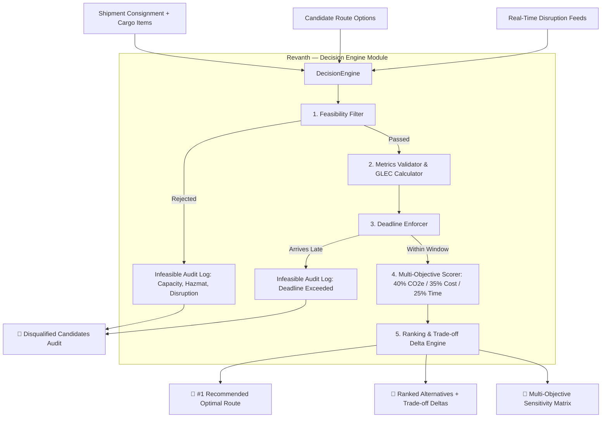

# ⚡ GreenGrid: AI-Powered Logistics Optimization System

> **Demonstration Use Case:** Formula 1 Logistics & FIA Net Zero 2030  
> **Assigned Role:** Revanth — Decision Engine (Core Business Logic)

---

## 🎯 Executive Overview

**GreenGrid** is an AI-powered logistics optimization system that recommends cost-effective, time-efficient, and sustainable shipping routes by analyzing transportation costs, Well-to-Wheel (WTW) $\text{CO}_2\text{e}$ emissions, strict delivery deadlines, and active geopolitical/climate disruptions.

In Formula 1 logistics, moving 1,500+ tonnes of critical freight (race cars, hybrid power units, spare chassis, telemetry, tire allocations, and hospitality infrastructure) across 24 Grand Prix destinations over 5 continents is subject to unforgiving operational windows. Freight accounts for **~49–70% of Formula 1's total carbon footprint**, making intelligent multi-objective route selection vital to achieving the **FIA Net Zero 2030** milestone.

---

## 👤 Revanth — Decision Engine Responsibilities

As the **Decision Engine**, Revanth's module serves as the primary optimization arbiter of GreenGrid, executing five core responsibilities:

1. **Filter Infeasible Transport Options:**
   - **Weight & Volume Limits:** Disqualifies options exceeding maximum payload or volumetric capacity.
   - **Dangerous Goods (Hazmat):** Enforces IATA DGR / IMO IMDG compliance for **UN Class 9 Lithium-ion traction batteries** (F1 350kW ERS-K Energy Stores) and **Class 3 Flammable Liquids** (Race fuel). Prohibits unauthorized belly-hold transport on commercial passenger aircraft.
   - **Temperature Control:** Guarantees climate-controlled reefer cargo for sensitive telemetry, carbon pre-pregs, and racing slicks.
   - **Active Disruption Severance:** Dynamically blocks routes traversing severed chokepoints (e.g. Red Sea / Bab-el-Mandeb closure, severe typhoon cones).
   - **Geographic Validity:** Rejects physical impossibilities (e.g., direct road transport across open oceans).

2. **Enforce Delivery Deadlines:**
   - Implements a hard constraint: Total lead time $\le$ Available schedule window ($T_{\text{deadline}} - T_{\text{ready}}$).
   - Integrates mode-specific reliability safety buffers (e.g. Air Charter: 3h, Rail: 8h, Maritime: 36h) to prevent missed Free Practice 1 (FP1) or FIA scrutineering.
   - Logs exact deficit hours if an option is rejected (e.g., *"Arrives 320.0 hours late"*).

3. **Calculate or Validate Cost, Transit Time, and $\text{CO}_2\text{e}$:**
   - **GLEC Framework & ISO 14083 Compliant Emissions Accounting:** Calculates Well-to-Wheel (WTW) emissions based on tonne-kilometers ($g\text{ CO}_2\text{e}/\text{t-km}$) and fuel classifications:
     - *Air Charter (Jet-A1):* $650\,g/\text{t-km}$
     - *Air Commercial (30% SAF blend):* $365\,g/\text{t-km}$ (30% lifecycle GHG reduction)
     - *Road Haulage (Euro 6 Diesel):* $75\,g/\text{t-km}$
     - *Road Haulage (100% HVO100 Renewable Biofuel):* $11.5\,g/\text{t-km}$ (**~85% net reduction**)
     - *Intermodal Rail (Electric Grid):* $22\,g/\text{t-km}$
     - *Ocean Container (VLSFO):* $12.5\,g/\text{t-km}$
   - **Cost Modeling:** Linehaul freight rates, fuel surcharges (BAF/FSC), terminal handling charges, customs clearance fees, and dangerous goods surcharges.
   - **Sanity Validation:** Inspects upstream inputs and corrects discrepancies against physical baselines.

4. **Apply Multi-Objective Scoring:**
   - Evaluates surviving eligible options using the mandated weighting:
     $$\mathbf{40\%\text{ Emissions}} \quad|\quad \mathbf{35\%\text{ Cost}} \quad|\quad \mathbf{25\%\text{ Time}}$$
   - Min-Max feature scaling normalizes disparate units ($\text{kg CO}_2\text{e}$, $\text{USD}$, $\text{hours}$) into $[0, 1]$ penalties:
     $$\text{Penalty}_i = 0.40 \cdot \hat{E}_i + 0.35 \cdot \hat{C}_i + 0.25 \cdot \hat{T}_i$$
     $$\text{GreenGrid Score}_i = 100 \times (1 - \text{Penalty}_i)$$
   - Sub-score contributions are reported transparently ($S_{CO2} \le 40$, $S_{cost} \le 35$, $S_{time} \le 25$).

5. **Return Best Eligible Option and Ranked Alternatives:**
   - Returns `#1 Recommended Route` with natural language justification.
   - Ranks alternatives with explicit **Trade-off Deltas** ($\Delta\text{Cost}$, $\Delta\text{CO}_2\text{e}$, $\Delta\text{Time}$).
   - Generates sensitivity analysis comparing standard GreenGrid against *Emergency Race Critical*, *F1 Net Zero 2030 Max Green*, and *Budget-Constrained* profiles.

---

## 🏗️ Architecture & Dataflow



---

## 🏎️ Formula 1 Logistics Scenarios Demonstrated

| Scenario | Origin $\to$ Destination | Consignment Details | Key Decision Challenge | Winning Route |
| :--- | :--- | :--- | :--- | :--- |
| **1. Melbourne to Shanghai** | `MEL` $\to$ `PVG` | 3,800 kg Ferrari Hybrid Power Units + Chassis (Hazmat Class 9) | 96h deadline. Ocean too slow (380h); passenger air rejects Class 9 batteries. | **SIA Cargo 30% SAF Blend via SIN** (Score: 75.0) |
| **2. Miami to Imola** | `MIA` $\to$ `BLQ` | 42,000 kg Paddock Sea Kit & Hospitality Rigging | 504h window. Red Sea closure blocks Suez corridor. Dedicated air charter too dirty/costly. | **Hapag-Lloyd Ocean to Genoa + HVO100 Biofuel Trucking** (Score: 90.0) |
| **3. Spa to Zandvoort** | `SPA` $\to$ `ZAN` | 28,000 kg European Garage Rigging & Transporters | 72h window. HVO100 renewable fuel vs Euro 6 fossil diesel vs electric rail. | **DHL 100% HVO100 Biofuel Mega-Trailer Fleet** (Score: 92.9) |

---

## 📁 Repository Structure

```
GreenGrid/
├── pyproject.toml              # Build & test configurations
├── README.md                   # Complete architectural guide
├── demo.py                     # Rich terminal telemetry showcase
├── dashboard.py                # Streamlit interactive decision cockpit
├── greengrid/
│   ├── __init__.py
│   ├── models/                 # Pydantic domain models
│   │   ├── cargo.py            # F1 CargoItem, HazmatClass, Shipment
│   │   ├── transport.py        # TransportOption, RouteLeg, FuelType
│   │   ├── disruption.py       # DisruptionEvent, Chokepoints
│   │   └── decision.py         # DecisionResult, RankedOption, ScoreBreakdown
│   ├── calculators/            # Physics & Logistics accounting
│   │   ├── emissions.py        # GLEC v2.0 / ISO 14083 carbon accounting
│   │   ├── cost.py             # Freight rates, fuel surcharges, hazmat fees
│   │   ├── transit_time.py     # Speeds, dwells, customs, reliability buffers
│   │   └── validator.py        # Sanity checking of upstream candidate metrics
│   ├── engine/                 # Core Decision Engine implementation
│   │   ├── feasibility.py      # Hard capacity, hazmat & disruption filter
│   │   ├── deadline.py         # Strict race weekend deadline enforcer
│   │   ├── scorer.py           # 40% emissions / 35% cost / 25% time engine
│   │   └── decision_engine.py  # Orchestrator & trade-off synthesizer
│   ├── data/
│   │   └── f1_scenarios.py     # Authentic Formula 1 Grand Prix datasets
│   └── api/
│       └── app.py              # FastAPI REST endpoints
└── tests/
    ├── test_feasibility.py     # Filter tests (capacity, hazmat, disruption)
    ├── test_deadline.py        # Deadline enforcement tests
    ├── test_calculators.py     # GLEC emissions, cost & transit tests
    ├── test_scorer.py          # Weighting & normalization tests
    ├── test_decision_engine.py # End-to-end scenario integration tests
    └── test_api.py             # REST API endpoint tests
```

---

## 🚀 Quickstart & Usage

### 1. Run the Rich Terminal Demonstration
Experience the F1 telemetry-style logistics terminal output:
```bash
python demo.py
```

### 2. Launch the Streamlit Interactive Cockpit
Launch the web cockpit with interactive weight sliders and Plotly charts:
```bash
streamlit run dashboard.py
```

### 3. Launch the FastAPI Microservice
Expose the Decision Engine REST API for other agentic workflows:
```bash
uvicorn greengrid.api.app:app --reload --port 8000
```
- Interactive Swagger UI: `http://localhost:8000/docs`
- Health check: `http://localhost:8000/health`

### 4. Execute the Automated Test Suite
Run 19 automated unit and integration tests:
```bash
pytest
```

---

## 🔗 Alignment with Reference Frameworks

- **[SCM_AGENTIC_WORKFLOW](https://github.com/sounakss7/SCM_AGENTIC_WORKFLOW):** Provides the decision arbiter node in an agentic supply chain graph, accepting candidate routes and outputting structured decisions.
- **[carbon-aware-supply-chain-optimization](https://github.com/lspusal/carbon-aware-supply-chain-optimization):** Aligns emission factors per mode with GLEC / ISO 14083 standards and performs Pareto frontier trade-off analysis.
- **[Route-Optimization-System](https://github.com/VTSLM/Route-Optimization-System) & [RouteIQ](https://github.com/sujalkrshaw/RouteIQ-Intelligent-Route-Optimization-and-Logistics-Analytics-Platform):** Implements lead-time dwell models, risk factor adjustments, and trade-off synthesis.
- **[PyVRP](https://github.com/PyVRP/PyVRP):** Treats capacity and time windows as hard constraints before multi-objective optimization.

---

**Developed for GreenGrid by Revanth — Decision Engine.**
